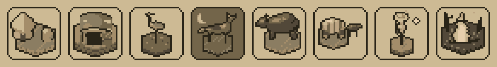

# Races: who you play, and how the end of the world treats them

A design for choosing a race at the start of a game instead of a fixed
civilization. Nothing here is built yet. The rules are in `GUIDE.md`, the
numbers in `src/defs.lua`; this is the design view, and every number below is
a first guess to be tuned by all-AI games as the cataclysms were.

## 1. Principles

1. **One signature rule, one or two small numbers, one real weakness.** A flat
   "+10% production" is forgotten by turn 20; a rule you play around is not.
2. **Bend the systems the game already has.** Day and night
   (`src/ui/daylight.lua`), rivers, the wild (`src/beasts.lua`), quarters
   (`src/quarters.lua`), the wards and the gear. A race should need few new
   subsystems.
3. **Every race meets the cataclysms differently.** Each is *favoured* by
   some endings and *feared* by others. The new game window becomes a match
   of race against ending ("Fenfolk: favoured by the deluge, feared by the
   heat"), and the same ending plays differently each time.
4. **A race is told by shape, never colour.** There are eight shades and no
   more. Races differ in their buildings, the build of their people, their
   boats, the shape of their banner, how their towns light at night, and
   the tune they are given in `src/synth.lua`.
5. **Everyone has a race, rivals too.** The rival leaders are each of a
   race and play by its rules, so a rival is as readable on the map as you
   are.

## 2. The races

### Hearthfolk: the lowland people

The baseline, and the race to learn on.

- **Look:** the towns as they are now: timber and gables on grassland,
  thatch and a windmill on the plains, mud brick and a dome in the desert,
  stone terraces on hills.
- **Signature, refuge:** when a city anywhere is lost to the cataclysm
  (sunk, burnt out, swallowed), a share of its people (half, at most 3)
  walk to the nearest Hearthfolk city within 8 hexes and join it.
- **Numbers:** a quarter houses 6, not 5.
- **Weakness:** none in particular. No ending favours them, none is feared.

### Moundfolk: the people under the hills

- **Look:** no towers. Round doors in the slopes, turf roofs, chimneys
  standing out of the grass, the lamplight coming up out of the ground at
  night. Short, broad people. Their quarters are dug in, not built up.
- **Signature, dug in:** a city on hills has a shelter from its founding.
  They may found a city beside a mountain, and a mine gives a production
  more.
- **Numbers:** walls cost half.
- **Weakness:** a food less from every flat hex a city works. Their
  burrows flood: the deluge's rising water and the great flood take their
  towns a stage early, and a levee holds them only through the first rising
  if it is on hills.
- **Favoured:** skyfall, heat death, the shattering (the buttress costs
  half). **Feared:** the deluge.

### Fenfolk: the people of the marsh and the rivers

- **Look:** houses on stilts over the water, reed boats, nets hung to dry
  between the houses. A quarter can go out over a water hex beside the
  city.
- **Signature, at home in the wet:** crossing a river costs them no more
  than any edge, marsh does not slow them, and their bands take to the
  coast in reed boats before Sailing.
- **Numbers:** a fishing boat gives a food more; a farm by a river a food
  more again.
- **Weakness:** a food less from desert and plains. A dry riverbed costs
  them twice what it costs anyone else.
- **Favoured:** the deluge (marsh feeds them, and the drowned shore is land
  they can use). **Feared:** heat death, the still sun's day side.

### Nightborn: the people of the dark

- **Look:** thin, pale people. Their towns are the one thing on the map
  that goes *dark* at night: no windows lit, only a faint glow under the
  eaves, and they light up at noon instead. Moth banners.
- **Signature, night eyes:** at night their units have +5 strength and +1
  sight, and wolves leave them be.
- **Numbers:** they grow a little slower (a food less in the capital).
- **Weakness:** −5 strength at noon.
- **Favoured:** the long night of the sky's falling, the still sun's night
  side (the cold takes half from them). **Feared:** the still sun's day side,
  heat death. Under the still sun, which side the line leaves them on is
  their whole game.

### Wildwardens: the people who keep the beasts

- **Look:** carved posts at the edge of town, pens, a wolf at a soldier's
  heel. Antlers over the doors.
- **Signature, kin to the wild:** the beasts do not attack them. A soldier
  who walks into a den or a cave may *tame* what lives there instead of
  clearing it: a wolf pair or a bear joins them as a unit. **Wolf** is a
  mount for a band from the start, needing no technology: +5 strength, 3
  moves (the horse stays better).
- **Numbers:** the omen comes to them 5 turns early; the beasts know.
- **Weakness:** half the loot from hunting, and a mine or quarry gives a gold
  less.
- **Favoured:** the abyss (beasts hate the demons; a tamed beast has +5
  against them). **Feared:** the plague (it goes through their pens and
  their beasts carry it as rats do).

### Wayfarers: the people who move on

The hard race, for players who know the endings.

- **Look:** tents and wagons, a town that always looks half packed. Horses
  everywhere.
- **Signature, uproot:** a city may pack itself into a **caravan**, a unit
  that walks (2 moves) and settles again anywhere a settler could. It keeps
  all but one of its people and half its buildings, chosen by the player;
  its land is given up. A city may uproot once every 20 turns.
- **Numbers:** Horseback Riding costs half.
- **Weakness:** no walls and no quarters; a city stops growing at 8.
- **Favoured:** whatever can be walked away from: the deluge's rising
  shore, the sundering's faults, the still sun's line. **Feared:** none, but
  their wards cost a quarter more, so they must run where others build.

### For later

- **Stargazers:** see every stone, quake and wave two turns ahead instead of
  one, and the still sun's line at turn 95. A Glory more for each win against
  the demons.
- **Ashborn:** fire does not harm their units or their land; ash and baked
  earth give them a food where they give anyone else nothing.

### The icons

One for each race, 32 by 32, in `assets/races/`. They are made of the game's
own models, traced afresh at the icon's size by the board's tracer, each on a
little hex of its land: `luajit tools/race_icons.lua dir` draws them.

| Race | What stands in it | From |
| --- | --- | --- |
| Hearthfolk | A farmhouse under its thatch and a haystack, on grass | `M.farm`, its walls left off |
| Moundfolk | A mine's adit: a mound with a dark door propped in timber, on hills | `M.mine` (workings), the ore left off |
| Fenfolk | A heron in the shallows | `M.heron` |
| Nightborn | A wolf howling, by night, under the moon | `M.beast("wolf")`, howling, a step darker as the board's night is |
| Wildwardens | A bear | `M.beast("bear")` |
| Wayfarers | The settler's covered wagon and its ox | `M.unit("settler")`, side on |
| Stargazers | Someone on a hill, and a star falling | `M.unit("scout")`; the star drawn as `src/ui/sky.lua` draws a stone coming |
| Ashborn | Burnt ground, charred snags, a fire | the burnt forest's snags (`src/world.lua`); the flame drawn as `src/ui/fire.lua` draws one |

## 3. Race against ending, on one page

| | Heat | Deluge | Skyfall | Abyss | Still sun | Plague | Shattering |
| --- | --- | --- | --- | --- | --- | --- | --- |
| **Hearthfolk** | – | – | – | – | – | – | – |
| **Moundfolk** | + | **−** | **+** | – | – | – | + |
| **Fenfolk** | **−** | **+** | – | – | − (day) | – | – |
| **Nightborn** | − | – | + | – | ± (by side) | – | – |
| **Wildwardens** | – | – | – | **+** | – | **−** | – |
| **Wayfarers** | ± | + | ± | – | + | – | + |

Bold is the race's main matchup. No ending should have two races strongly
favoured and none feared; look at this table each time a race is added.

## 4. The rival leaders

Each leader is of a race and plays by it; their leaning
(`leaning` and `reserve` in `D.CIVS`, `src/ai.lua`) is how they play it.
The two rivals there are now keep their names, their looks and their
leanings, and are given the race their leaning already fits.

| Leader | Civilization | Race | Look | How they play |
| --- | --- | --- | --- | --- |
| **Queen Nocta** | Umbra | Nightborn | dark | War. Leans to Archery, Bronze, Horseback Riding and Iron; keeps a war chest of 160. Attacks at night and pulls back by day |
| **King Tess** | Varro | Moundfolk | stripe | Building. Leans to Pottery, Masonry, Writing, Mining; spends to 40 on walls and wards. Settles hills first |
| **Elder Brannoch** | Thistle | Hearthfolk | light | Growth. Leans to Pottery, Irrigation and Currency; settles widest, takes in refugees, keeps 80 |
| **Mother Sedge** | Reedholm | Fenfolk | stripe | Water. Leans to Sailing, Irrigation and Shipbuilding; settles rivers and coast first, builds ships early |
| **The Houndwife** | Garrow | Wildwardens | dark | Hunting. Leans to Archery and Horseback Riding; tames every den near her, uses beasts as her army |
| **Khan Orrin** | the Drift | Wayfarers | light | Opportunist. Leans to Horseback Riding and Currency; uproots cities ahead of the cataclysm, raids |

New names stand in for whatever we choose; cities for each need lists like
the ones in `D.CIVS`.

**Built so far (the leaders, without their races):** Nocta, Tess,
Brannoch (Thistle), Sedge (Reedholm) and Orrin (Driftland, not "the Drift")
are in `D.CIVS`, each with the leaning, temper and AI traits above that
need no race rule (Brannoch's refugees, Orrin's uprooting and the
Houndwife's taming wait for the races). A game draws 1 to 5 of them as the
new game window says. The Houndwife waits for taming, and for a sixth look.

**Who you meet.** The player picks a race. The two rivals are drawn from the
leaders of the *other* races, so no game has two civilizations of the same
race until there are two leaders for each. A second leader per race (one
for war, one for building) is the way to give more variety later.

**Your civilization.** Aurelia stays the player's name; its look and its
city names come from the race chosen (a list for each race).

## 5. Diplomacy, when it comes

- **How races see each other.** A table of starting regard between races:
  Moundfolk and Fenfolk distrust each other (hill against flood);
  Wildwardens and Nightborn get on (they share the night and the wolves);
  Wayfarers get on with everyone and are trusted by no one; Hearthfolk are
  liked a little by all.
- **A diplomatic act for each race.**
  - Hearthfolk: *offer refuge*. Take in another civilization's people when
    it loses a city; regard rises.
  - Moundfolk: *lend masons*. Another civilization's ward is built faster
    for gold.
  - Fenfolk: *river pact*. Both sides cross each other's rivers and coasts
    freely.
  - Nightborn: *night watch*. Share sight at night.
  - Wildwardens: *lend beasts*. Give a tamed beast to an ally.
  - Wayfarers: *trade*. A caravan to a foreign city gives both sides gold.
  - Stargazers: *sell a warning*. Show another civilization where the next
    strikes fall, for gold.
- **The cataclysm moves the diplomacy.** From the omen on, a race that fears
  the ending looks for friends and a race favoured by it grows bold. This is
  where refugees matter most: who takes them in, and who closes the gates.

## 6. How it would be built

1. **`src/defs.lua`:** a `D.RACES` table. For each race: its name, numbers,
   rule flags (`refuge`, `dugIn`, `wetFoot`, `nightEyes`, `wildKin`,
   `uproot`), the endings it is favoured and feared by, its city names and
   its look. `D.CIVS` gives each leader a `race`; the player's civilization
   takes the one chosen.
2. **`src/game.lua`:** each rule read from the player's race where the
   matching rule lives now: moves across rivers, combat strength by the hour,
   the beasts' choice of target, food by terrain, housing in quarters, a
   city lost to the cataclysm.
3. **`src/models.lua`:** `M.city` and the quarters take the race beside the
   land; units take it for their build. The land variants there now are the
   pattern to follow, and `luajit tools/cities.lua` draws the sheets to
   check them.
4. **The new game window (`src/ui/menu.lua`):** a race row beside the
   endings, with a small picture of the race's town, and the matchup line
   for the ending chosen. The choice is kept, and `love . --race fen`
   overrides it, as `--cataclysm` does.
5. **`src/ai.lua`:** the leaders' leanings above, and the race rules the
   computer must know to use them (when to uproot, when to tame, fighting
   by night).
6. **`src/save.lua`:** each civilization's race is kept with the game.

**First round:** Hearthfolk, Moundfolk and Fenfolk, with Nocta made
Nightborn in numbers only (night strength) until the Nightborn's towns are
drawn. They are mostly numbers, terrain and models, and between them cover
heat, deluge and skyfall. **Second round:** the Nightborn's towns, the
Wildwardens and the Wayfarers, which need new rules (taming, uprooting).
**Then:** diplomacy, built on the regard table and the acts above.
